# The scale screens: a visual guide

How to read and work the screens for SLOOP's 52 scales (Western, Turkish, Arabic, Indian), quarter tones and step bends. The images are the firmware's own screen, rendered on a computer: what you see on the FM-1 is the same.

Two words used throughout:
- **Half-flat** (written `Ed` in text, and `E` with a reversed flat on the screen) is a quarter tone, 50 cents, below the note: E half-flat sits halfway between E♭ and E.
- **Half-sharp** (written `E+`, `E` with a one-stem sharp) is a quarter tone above.

There are two ways into the scales:

| | How | What it changes |
|---|---|---|
| **The KEY layer** | **hold SCL** | the key of the whole song (all three synth tracks), the scale set, the tuning |
| **The SCL page** | **tap SCL** | the selected track's root, scale, keys mode and chords |

Most of the time you want the **KEY layer**.

---

## 1. The KEY layer (hold SCL)

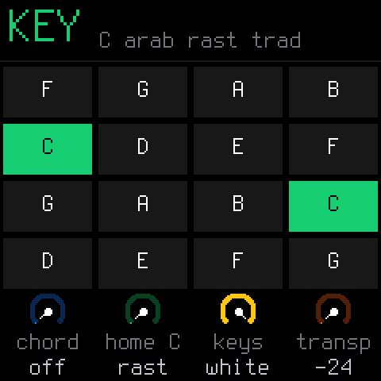

**The title bar** reads *root, set, scale, tuning*: `C arab rast trad` means:
- Rast, from the Arabic set,
- with C as its root,
- in TRADITIONAL tuning.

**The 16 tiles are the 16 white keys** of the FM-1, in the same order:
- Top row: F G A B.
- Second row: C D E F.
- Third row: G A B C.
- Bottom row: D E F G.

What the tiles show:
- **Green tiles** are the root: here both C keys.
- **White text** marks a key whose note, or a quarter tone either side of it, is in the scale. In Rast, E is lit because E half-flat is right next to it.
- **Dim text** marks a key with no scale note nearby. Rast uses them all; see Segah below for dim ones.

**While SCL is held:**

| Control | Does |
|---|---|
| **a key** (white or black) | sets the root to that note |
| **OCT− + a key** | root a quarter tone lower: OCT− + E = E half-flat |
| **OCT+ + a key** | root a quarter tone higher |
| **PRESETS** | the scale **set**: WEST → TURK → ARAB → INDIA (jumps to the set's first scale) |
| **KNOB 1 chord** | chord mode: off, triad, 7th, 9th, sus4, power |
| **KNOB 2 scale** | the scale, within the current set (it wraps around) |
| **KNOB 3 keys** | how the keys play the scale: off, snap, white (see below) |
| **KNOB 4 transp** | transposes the track by semitones (this preset starts at −24) |
| **ALGORITHM** | tuning: turn right for **TRADITIONAL**, left for **EQUAL** |

### The home hint

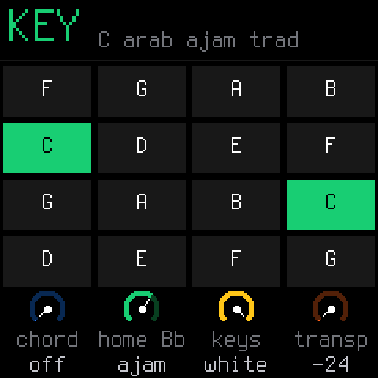

For Turkish, Arabic and Indian scales, the label over KNOB 2 shows the scale's **traditional home**, here `home Bb` for Ajam. It is **only a hint**:
- Choosing a scale never changes your root. Ajam plays from C here.
- To play it at home, press B♭ while SCL is held.
- Any scale works from any root, with the same intervals and tuning.

### The three keys modes (KNOB 3)

| `white` | `snap` |
|---|---|
|  | 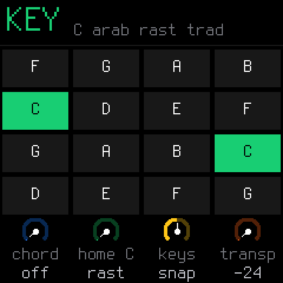 |

- **white:** the white keys walk the scale's notes in order, starting from C4 = the root, and the black keys are silent. A 7-note maqam fits one octave in 7 white keys, so it's the easiest way to play any maqam. **Recommended.**
- **snap:** every key plays. Each key covers its own note and the quarter tone above it, and plays the scale note at or just below. In Rast on C, both E♭ and E play E half-flat.
- **off:** plain chromatic keys. Hold **OCT−** or **OCT+** while pressing a key to get a half-flat or half-sharp anywhere.

**Up and down can differ.** On a synth track, a key **lower than the last one** uses the scale's descending form. In Rast on C, the 7th is B half-flat going up and B♭ coming down. What you hear is what gets recorded.

### Chords on a maqam

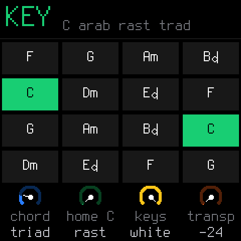

With **KNOB 1 chord** on, each tile shows the chord its key plays. In Rast, the chords on E and B are built on **E half-flat** and **B half-flat** (`E` and `B` with the half-flat glyph). They are *neutral* chords, neither major nor minor.

### TRADITIONAL vs EQUAL

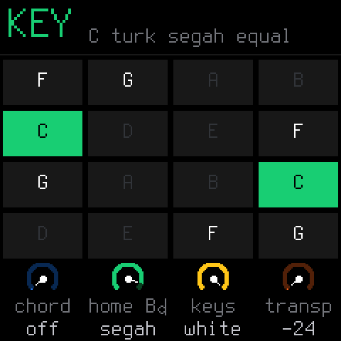

- **EQUAL** puts every note on the plain quarter-tone grid.
- **TRADITIONAL** (the default) nudges each note by a few cents, up to ±25, towards the tradition's own tuning:
  - Turkish: Pythagorean ratios.
  - Arabic: al-Ṣabbāgh (1954).
  - Indian: just intonation.

Hold a note, then turn ALGORITHM back and forth: the pitch moves slightly. Western scales are the same in both. The title bar shows `trad` or `equal`.

The dim tiles here (D, E, A, B) are keys with no note of Segah nearby. `home` shows `B` with the half-flat glyph, Segah's traditional root.

---

## 2. The SCL page (tap SCL)

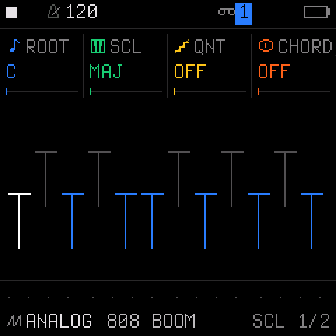

The top row has four values, one per knob: **ROOT**, **SCL** (scale), **QNT** (keys mode) and **CHORD**.
- They apply to **the selected track only**.
- Here KNOB 2 steps through **all 52 scales in one list**, in the same order as the sets: WEST, then TURK, ARAB and INDIA. The bar under each value shows its position.

### The diagram, explained

The picture under the values is **a one-octave keyboard, C to B, seen from the side**:

```
      C# D#    F# G# A#        tall marks  = black keys
     C  D  E  F  G  A  B       short marks = white keys

   white mark = the root key
   blue mark  = a key that is in the scale (its note, or a quarter tone next to it)
   grey mark  = a key that is not in the scale
```

- **WEST major on C** (above): the root C is white, D E F G A B are blue, and the black keys are grey. That's the plain major scale.
- **ARAB Rast on C** (below, left): D# and E are both blue. That's because E half-flat sits *between* them. Likewise A# and B are both blue, because of B half-flat.
- **ARAB Sikah on E half-flat** (below, right): **two** marks are white, D# and E, because the root itself sits between them.

| Rast on C | Sikah on E half-flat |
|---|---|
| 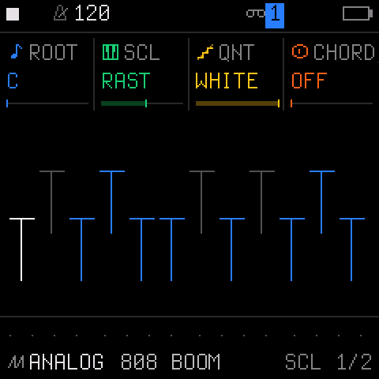 | 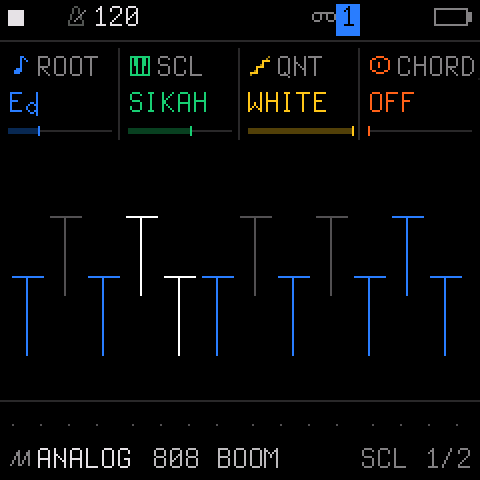 |

**The diagram can't show quarter tones exactly.** It lights the keys that *reach* a scale note. Two blue keys side by side with a missing note between them, like D# and E in Rast, mean "a half-flat lives here". For the exact notes, use the tiles in the KEY layer with chords on, or record the scale and read the step tiles (section 3).

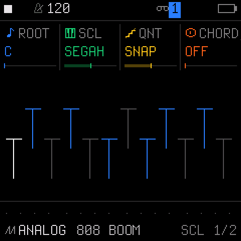

*TURK Segah on C:* only the keys near Segah's notes are blue. The QNT value shows `SNAP`.

---

## 3. Steps with quarter tones and bends

### The STEPS layer (hold SEQ)

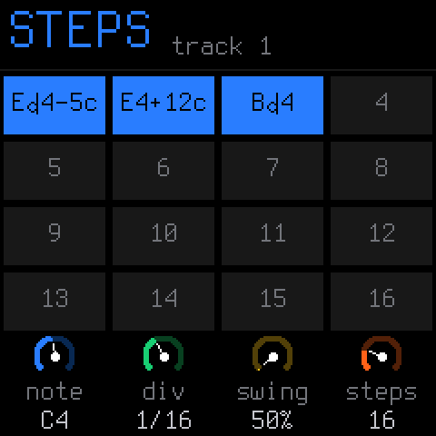

Each tile is a step. A step that holds a note shows its name, with the half-flat or half-sharp glyph, and its **bend** in cents when it isn't 0:
- `E` half-flat `4−5c` is E half-flat, 5 cents flat.
- `E4+12c` is E, 12 cents sharp.
- `B` half-flat `4` is B half-flat with no bend.

When the label would be too long, the `c` is dropped.

### The STEP page (tap SEQ)

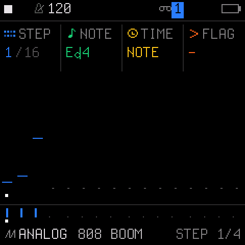

| Control | Does |
|---|---|
| **KNOB 1 STEP** | which step you're editing (1/16) |
| **KNOB 2 NOTE** | moves the note by **semitones** and **keeps its quarter tone** (E half-flat + 2 = F# half-flat) |
| **OCT− or OCT+ held + KNOB 2 NOTE** | moves the note by **quarter tones** (E, then one detent down = E half-flat); the octave doesn't change when you let go |
| **KNOB 3 TIME, KNOB 4 FLAG** | as before (note / tie / rest; accent, slide) |

The picture underneath is the pattern: each short line is a step's pitch, and the dots mark the steps.

### STEP 2 (tap SEQ again): the bend

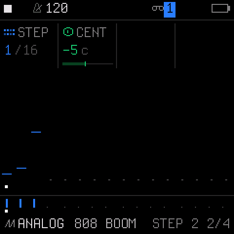

| Control | Does |
|---|---|
| **KNOB 1 STEP** | which step |
| **KNOB 2 CENT** | the step's bend, from **−63 to +63 cents**, one cent per detent |

The bend applies to every note of the step, so a chord bends as a whole. In TRADITIONAL tuning it **adds** to the scale's own tuning, up to ±100 cents in total. Bends and quarter tones are saved with the project.

---

## Quick recipes

- **Play a maqam in two moves.**
  1. Hold **SCL**, then:
     - turn **PRESETS** to `arab`;
     - turn **KNOB 2** to the maqam;
     - set **KNOB 3** to `white`;
     - press the root key.
  2. Let go and play the white keys up and down.
- **Hear the traditional tuning.** Hold a note, hold SCL, and turn **ALGORITHM** left (`equal`) then right (`trad`).
- **One quarter tone anywhere.** On a synth track, hold **OCT−** (lower) or **OCT+** (higher) and press the key.
- **Fine-tune one step.** Tap **SEQ** twice (STEP 2), pick the step with KNOB 1, and turn **KNOB 2 CENT**.
